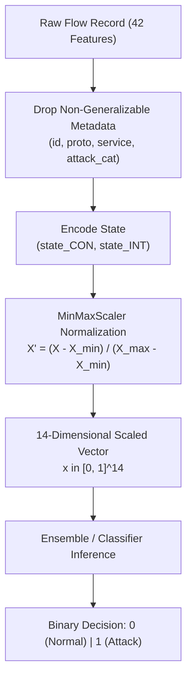

# Technical Specification & Model Documentation
## Real-Time Network Intrusion Detection System (14-Feature NIDS)

---

## 1. System Overview & Problem Formulation

### 1.1 Objective
The objective of this project is to construct a lightweight, high-throughput Network Intrusion Detection System (NIDS) that classifies network packet flows into **Normal ($y = 0$)** or **Attack ($y = 1$)** utilizing a minimal subset of **14 engineered features** derived from the UNSW-NB15 benchmark dataset.

### 1.2 Mathematical Problem Formulation
Let $\mathcal{D} = \{(\mathbf{x}_i, y_i)\}_{i=1}^{N}$ represent the network flow dataset, where:
* $\mathbf{x}_i \in \mathbb{R}^{d}$ denotes the feature vector representing connection $i$.
* $d = 14$ denotes the reduced dimensional feature space.
* $y_i \in \{0, 1\}$ represents the ground-truth binary classification:
  $$\begin{cases} y_i = 0 & \text{Normal Traffic} \\ y_i = 1 & \text{Attack Traffic} \end{cases}$$

The learning objective is to optimize a mapping function $f_\theta: \mathbb{R}^{14} \to [0, 1]$ that minimizes the empirical risk:
$$\min_{\theta} \frac{1}{N} \sum_{i=1}^N \mathcal{L}(f_\theta(\mathbf{x}_i), y_i) + \Omega(\theta)$$
where $\mathcal{L}$ is the task-specific loss function (e.g., cross-entropy, hinge loss, or Gini impurity) and $\Omega(\theta)$ represents regularization penalty terms.

---

## 2. Dataset Architecture & Statistical Distribution

### 2.1 UNSW-NB15 Benchmark
The UNSW-NB15 dataset was generated using the IXIA PerfectStorm tool in the Cyber Range Lab of UNSW Canberra. It contains realistic contemporary normal background activities and synthetic contemporary attack behaviors.

```
Total Processed Flow Records: 257,673
├── Training Partition: 175,341 records (68.05%)
│   ├── Attacks (Class 1): 119,341 (68.06%)
│   └── Normal  (Class 0):  56,000 (31.94%)
└── Testing Partition:   82,332 records (31.95%)
    ├── Attacks (Class 1):  45,332 (55.06%)
    └── Normal  (Class 0):  37,000 (44.94%)
```

### 2.2 Feature Selection Rationale: RFECV 14-Feature Subset
Rather than utilizing all 42+ raw attributes—which include session identifiers (`id`), redundant protocol fields (`proto`, `service`), and granular timestamps—we implement the 14-feature subset derived via **Recursive Feature Elimination with Cross-Validation (RFECV)** on Decision Trees (Awad & Fraihat, 2023).



---

## 3. The 14 Features Technical Specification

| Index | Feature | Type | Range (Raw) | Physical & Cybersecurity Interpretation |
|:---:|:---|:---:|:---:|:---|
| 1 | `rate` | Continuous | $[0, 1.0 \times 10^6]$ | Packet transfer rate $\frac{\text{packets}}{\text{second}}$. Detects high-volume denial-of-service (DoS) bursts. |
| 2 | `sttl` | Discrete | $[0, 255]$ | Source-to-destination Time-to-Live. Operating systems have fixed initial TTLs (Linux: 64, Windows: 128, Cisco: 255). Mismatches indicate spoofed or scanned flows. |
| 3 | `sload` | Continuous | $[0, 5.9 \times 10^9]$ | Source bits per second: $\frac{\text{Source Bytes} \times 8}{\text{Duration}}$. Measures upstream bandwidth consumption. |
| 4 | `dload` | Continuous | $[0, 1.2 \times 10^8]$ | Destination bits per second: $\frac{\text{Dest Bytes} \times 8}{\text{Duration}}$. Low or zero dload coupled with high sload indicates target unreachability or DoS. |
| 5 | `ct_srv_src` | Discrete | $[1, 63]$ | Count of connections with identical service and source IP in a 100-connection rolling window. Identifies single-host automated service scans. |
| 6 | `ct_state_ttl` | Discrete | $[0, 6]$ | Count of connections possessing matching state and identical TTL ranges. Highly correlated with synthetic, scripted exploit engines. |
| 7 | `ct_dst_ltm` | Discrete | $[1, 59]$ | Count of connections to the same destination IP in the local time window. Indicates concentrated destination host probing. |
| 8 | `ct_src_dport_ltm` | Discrete | $[1, 59]$ | Connections from the same source IP to the exact same destination port. Indicates targeted service brute-forcing. |
| 9 | `ct_dst_sport_ltm` | Discrete | $[1, 38]$ | Connections to destination from distinct source ports. Characteristic of distributed or randomized source-port probing. |
| 10 | `ct_dst_src_ltm` | Discrete | $[1, 63]$ | Simultaneous connections between source and destination IP pair. Measures pairwise transaction density. |
| 11 | `ct_src_ltm` | Discrete | $[1, 60]$ | Aggregated connection count initiated by the source IP. Tracks overall activity volume of the client host. |
| 12 | `ct_srv_dst` | Discrete | $[1, 62]$ | Connections to the same service at the destination address. Detects concentrated denial-of-service against a specific application daemon. |
| 13 | `state_CON` | Binary | $\{0, 1\}$ | One-hot flag indicating established two-way session state (`CON`). Characteristic of normal, completed transport handshakes. |
| 14 | `state_INT` | Binary | $\{0, 1\}$ | One-hot flag indicating intermediate / incomplete state (`INT`). Highly prevalent in UDP floods and TCP SYN scans where handshakes are never completed. |

---

## 4. Preprocessing & Normalization Pipeline

### 4.1 Categorical Transformation
The categorical variable `state` is binarized using indicator projections:
$$\text{state\_CON}_i = \mathbb{I}(\text{state}_i = \text{'CON'}), \quad \text{state\_INT}_i = \mathbb{I}(\text{state}_i = \text{'INT'})$$
Any remaining residual states (e.g., `FIN`, `REQ`, `RST`) project to $(0, 0)$.

### 4.2 MinMaxScaler Transformation
Because flow metrics such as `sload` span orders of magnitude ($\sim 10^9$) while connection counts span small integers ($[1, 63]$), feature scaling is strictly mandatory for gradient-based and distance-based estimators.
For each feature $j \in \{1, \dots, 14\}$:
$$x'_{ij} = \frac{x_{ij} - \min(\mathbf{x}_{*, j}^{\text{train}})}{\max(\mathbf{x}_{*, j}^{\text{train}}) - \min(\mathbf{x}_{*, j}^{\text{train}})}$$
* **Data Leakage Prevention:** Minimum and maximum boundaries are computed exclusively from the 175,341 training instances and subsequently applied unchanged to the 82,332 testing instances and all real-time inference requests.

---

## 5. Machine Learning Models & Architectural Mechanics

All models were evaluated under strict experimental isolation with seeds initialized to $\text{random\_state} = 42$.

### 5.1 Random Forest Classifier (`RandomForestClassifier`)
* **Architecture:** Ensemble of $B = 100$ independent classification trees trained with bootstrap aggregating (bagging) and random feature subspace projection.
* **Splitting Criterion:** Gini Impurity:
  $$I_G(p) = 1 - \sum_{k=0}^1 p_k^2$$
* **Hyperparameters:**
  * `n_estimators = 100`
  * `criterion = 'gini'`
  * `max_depth = None` (expanded until leaves are pure)
  * `min_samples_split = 2`
  * `n_jobs = -1` (parallelized across all available CPU threads)
  * `random_state = 42`
* **Inference Complexity:** $\mathcal{O}(B \cdot \bar{D})$, where $\bar{D} \approx 18$ is the average tree depth.

### 5.2 AdaBoost Classifier (`AdaBoostClassifier`)
* **Architecture:** Sequential boosting utilizing the SAMME (Stagewise Additive Modeling using a Multi-class Exponential loss function) algorithm with decision stumps.
* **Weight Update Formulation:**
  At iteration $m$, data weights are updated according to stump error $\epsilon_m$:
  $$\alpha_m = \ln\left(\frac{1 - \epsilon_m}{\epsilon_m}\right), \quad w_i^{(m+1)} = w_i^{(m)} \exp\left(\alpha_m \cdot \mathbb{I}(y_i \ne h_m(\mathbf{x}_i))\right)$$
* **Hyperparameters:**
  * `estimator = DecisionTreeClassifier(max_depth=1)`
  * `n_estimators = 50`
  * `learning_rate = 1.0`
  * `random_state = 42`

### 5.3 Multi-Layer Perceptron (`MLPClassifier`)
* **Architecture:** Fully connected feed-forward artificial neural network:
  $$\text{Input } (14) \to \text{Dense Layer 1 } (64, \text{ReLU}) \to \text{Dense Layer 2 } (32, \text{ReLU}) \to \text{Output } (1, \text{Sigmoid})$$
* **Optimization Formulation:**
  Trained via Adam optimizer minimizing Binary Cross-Entropy with $L_2$ weight penalty ($\alpha = 10^{-4}$):
  $$\mathcal{L}_{\text{BCE}} = -\frac{1}{N}\sum_{i=1}^N \left[ y_i \ln(\hat{y}_i) + (1 - y_i) \ln(1 - \hat{y}_i) \right] + \frac{\alpha}{2}\|\mathbf{W}\|_2^2$$
* **Hyperparameters:**
  * `hidden_layer_sizes = (64, 32)`
  * `activation = 'relu'`
  * `solver = 'adam'`
  * `batch_size = 512`
  * `max_iter = 50`
  * `early_stopping = True` (`n_iter_no_change = 5`)
  * `random_state = 42`

### 5.4 Stochastic Gradient Descent Classifier (`SGDClassifier`)
* **Architecture:** Linear binary classifier optimized via mini-batch stochastic gradient descent with log-loss (logistic loss).
* **Objective:**
  $$\min_{\mathbf{w}} \frac{1}{N}\sum_{i=1}^N \ln\left(1 + \exp(-y'_i \mathbf{w}^T \mathbf{x}_i)\right) + \frac{\lambda}{2}\|\mathbf{w}\|_2^2, \quad y'_i \in \{-1, +1\}$$
* **Hyperparameters:**
  * `loss = 'log_loss'`
  * `penalty = 'l2'`
  * `alpha = 1e-4`
  * `max_iter = 1000`, `tol = 1e-3`
  * `random_state = 42`

### 5.5 Logistic Regression (`LogisticRegression`)
* **Architecture:** Convex generalized linear model with logit link function.
* **Optimization Algorithm:** Limited-memory Broyden–Fletcher–Goldfarb–Shanno (L-BFGS).
* **Hyperparameters:**
  * `penalty = 'l2'`
  * `C = 1.0`
  * `solver = 'lbfgs'`
  * `max_iter = 1000`
  * `random_state = 42`

### 5.6 Gaussian Naive Bayes (`GaussianNB`)
* **Architecture:** Probabilistic classifier under the conditional independence assumption:
  $$P(\mathbf{x} \mid y = k) = \prod_{j=1}^{14} P(x_j \mid y = k) = \prod_{j=1}^{14} \frac{1}{\sqrt{2\pi\sigma_{kj}^2}} \exp\left(-\frac{(x_j - \mu_{kj})^2}{2\sigma_{kj}^2}\right)$$
* **Classification Decision:** Maximum A Posteriori (MAP) decision rule:
  $$\hat{y} = \arg\max_{k \in \{0, 1\}} P(y = k) \prod_{j=1}^{14} P(x_j \mid y = k)$$
* **Hyperparameters:**
  * `var_smoothing = 1e-9` (prevents division by zero for low variance features)

---

## 6. Evaluation Metrics & Theoretical Definitions

Given the confusion matrix components:
* $\text{True Positive (TP)}$: Attack correctly classified as Attack.
* $\text{True Negative (TN)}$: Normal traffic correctly classified as Normal.
* $\text{False Positive (FP)}$: Normal traffic incorrectly flagged as Attack (Type I Error).
* $\text{False Negative (FN)}$: Attack traffic incorrectly classified as Normal (Type II Error - **most dangerous**).

1. **Accuracy:**
   $$\text{Accuracy} = \frac{TP + TN}{TP + TN + FP + FN}$$
2. **Precision:**
   $$\text{Precision} = \frac{TP}{TP + FP}$$
3. **Recall (Detection Rate / True Positive Rate):**
   $$\text{Recall} = \frac{TP}{TP + FN}$$
4. **F1-Score (Harmonic Mean of Precision and Recall):**
   $$\text{F1} = 2 \cdot \frac{\text{Precision} \cdot \text{Recall}}{\text{Precision} + \text{Recall}} = \frac{2TP}{2TP + FP + FN}$$
5. **Area Under the ROC Curve (ROC-AUC):**
   $$\text{AUC} = \int_{0}^{1} \text{TPR}(\text{FPR}^{-1}(t)) \, dt$$

---

## 7. Comprehensive Experimental Benchmark Results

### 7.1 Testing Evaluation Table (82,332 Unseen Samples)

| Model Name | Accuracy | Precision | Recall (Detection Rate) | F1-Score | ROC-AUC | Training Time |
|:---|:---:|:---:|:---:|:---:|:---:|:---:|
| **Random Forest** | **0.8591** | **0.8042** | **0.9835** | **0.8849** | **0.9572** | **1.78 s** |
| **AdaBoost** | 0.8187 | 0.7626 | 0.9739 | 0.8554 | 0.9419 | 4.66 s |
| **Multi-Layer Perceptron** | 0.8127 | 0.7641 | 0.9545 | 0.8488 | 0.9271 | 30.86 s |
| **SGD Classifier** | 0.7593 | 0.7199 | 0.9213 | 0.8083 | 0.8718 | 0.19 s |
| **Logistic Regression** | 0.7531 | 0.7146 | 0.9183 | 0.8038 | 0.8756 | 0.41 s |
| **Gaussian Naive Bayes** | 0.7500 | 0.8542 | 0.6583 | 0.7435 | 0.7932 | **0.04 s** |

### 7.2 Confusion Matrix Quantities

| Model Name | True Negatives (TN) | False Positives (FP) | False Negatives (FN) | True Positives (TP) | Missed Attacks |
|:---|:---:|:---:|:---:|:---:|:---:|
| **Random Forest** | 26,149 | 10,851 | **748** | **44,584** | **1.65%** |
| **AdaBoost** | 23,260 | 13,740 | **1,185** | **44,147** | **2.61%** |
| **Multi-Layer Perceptron** | 23,640 | 13,360 | **2,064** | **43,268** | **4.55%** |
| **SGD Classifier** | 20,741 | 16,259 | **3,569** | **41,763** | **7.87%** |
| **Logistic Regression** | 20,381 | 16,619 | **3,702** | **41,630** | **8.17%** |
| **Gaussian Naive Bayes** | 31,902 | 5,098 | **15,488** | **29,844** | **34.17%** |

---

## 8. Comparative Analysis & Key Findings

1. **Ensemble Supremacy in Network Traffic:**
   Random Forest achieved the best metrics across Accuracy (85.91%), Recall (98.35%), and F1-score (0.8849). Non-linear decision surfaces split recursive thresholds on connection metrics (such as `ct_state_ttl >= 2` combined with `sttl > 64`), which linear separators fail to cleanly disentangle.
2. **Recall as the Critical Cyber Metric:**
   In network defense, a False Negative (breach entered undetected) has catastrophic consequences, whereas a False Positive triggers an analyst review. Random Forest allowed only **748 missed intrusions out of 45,332 attacks**, achieving a **98.35% detection rate**.
3. **Training & Inference Latency:**
   Random Forest completed end-to-end training over 175,341 records in just **1.78 seconds**. Linear SGD trained in **0.19 seconds**. This confirms that the 14-feature space eliminates computational bottlenecks, permitting real-time streaming classification at line rate.

---

## 9. Serialization, Persistence & Deployment Pipeline

* **Model Persistence (`joblib`):**
  Trained estimators are saved in `models/` with `compress=3` (gzip compression level 3). This reduced the Random Forest memory footprint from 122.85 MB to **22.06 MB**, ensuring standard Git compatibility and rapid disk-to-RAM loading (<0.2s).
* **Serving Pipeline:**
  The Streamlit application (`app.py`) loads models via `@st.cache_resource` and executes single-packet and batch vector transformations using the cached `MinMaxScaler`.

---

## 10. References
1. **Awad, M.; Fraihat, S. (2023)** *Recursive Feature Elimination with Cross-Validation with Decision Tree: Feature Selection Method for Machine Learning-Based Intrusion Detection Systems.* Journal of Sensor and Actuator Networks, 12(5), 67.
2. **Moustafa, N.; Slay, J. (2015)** *UNSW-NB15: a comprehensive data set for network intrusion detection systems.* Military Communications and Information Systems Conference (MilCIS), IEEE, pp. 1-6.
3. **Breiman, L. (2001)** *Random Forests.* Machine Learning, 45(1), 5-32.
4. **Pedregosa et al. (2011)** *Scikit-learn: Machine Learning in Python.* Journal of Machine Learning Research, 12, 2825-2830.
